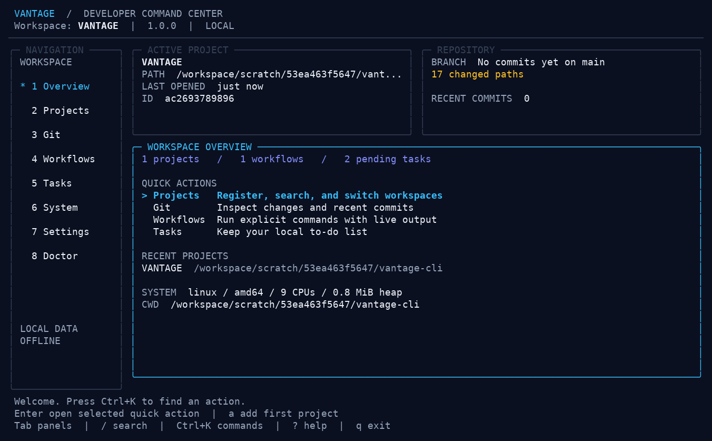
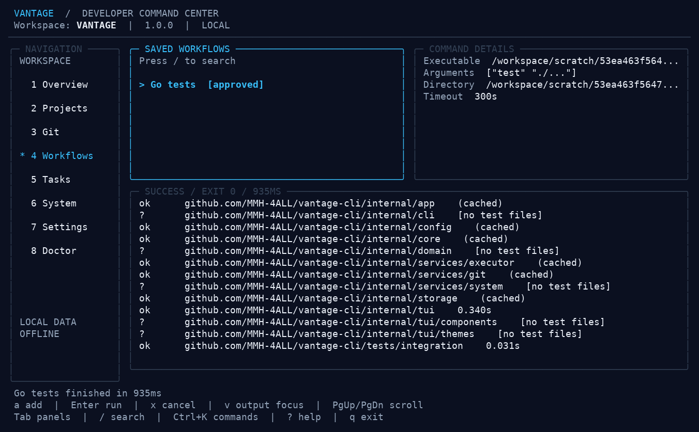

# VANTAGE

**Your entire development workspace. One terminal.**

Vantage Developer Command Center is a local terminal app for moving between projects, checking Git, running repeatable commands, and keeping small task lists. It uses Go, Bubble Tea, Bubbles, Lip Gloss, and Cobra. You can use the dashboard or script its CLI commands. It has no accounts, subscriptions, network service, or runtime telemetry.



The screenshots show the actual application running against a local checkout. They are captured from a terminal session, with no generated interface data.

## What works in 1.0

| Area | Functionality |
| --- | --- |
| Projects | Register, search, inspect, activate, open in an editor, and unregister folders without deleting their files |
| Git | Actual branch, root, staged/unstaged/untracked changes, renames, 15 recent commits, and remotes with URL credentials removed |
| Workflows | Literal executable and arguments, project association, working directory, timeout, nonsecret overrides, live environment references, approval, cancellation, bounded live output, exit status |
| Tasks | Add, edit, complete, reopen, delete, associate with projects, and filter by status or active project |
| System | OS, architecture, logical CPUs, hostname, runtime, heap, runtime memory reservation, application uptime, CWD, and Linux RSS when available |
| Navigation | Sidebar, searchable command palette, list search, keyboard controls, scrollable help, and resize handling |
| Settings | Midnight, light, and monochrome themes; TOML settings; editor arguments; Git path; startup screen; refresh; animation and editor-confirmation preferences |
| Doctor | Checks settings, database, executables, data-directory access, terminal capability, and workflow validity |

Git operations are read only. Opening a project does not run its scripts. All data stays in local files unless a workflow you deliberately run sends it elsewhere.

Git inspection disables external content filters, filesystem monitors, pagers, and automatic signature verification. Submodule working trees are not inspected. Repositories that depend on content filters can show different status results because those programs are intentionally bypassed.

## Installation

Prepared archives contain a standalone binary, this README, the MIT license, and dependency notices. Choose your OS and CPU architecture, verify its entry in `checksums.txt`, and extract it. Go is required to build from source, not to use a binary.

### Linux and Chromebook Linux environments

For an AMD64 archive already downloaded to your current folder:

```sh
unzip vantage_1.0.0_linux_amd64.zip -d vantage-release
mkdir -p "$HOME/.local/bin"
install -m 755 vantage-release/vantage "$HOME/.local/bin/vantage"
"$HOME/.local/bin/vantage" version
```

Use the `linux_arm64` archive on ARM64 machines. Add `~/.local/bin` to your PATH if you want to type `vantage` from any folder. No root access or system-wide installation is needed. Ubuntu, Debian, Fedora, Arch, and ChromeOS Linux containers are intended targets; only the environments listed in [the engineering report](docs/ENGINEERING_REPORT.md) have been tested.

### Windows PowerShell

For an AMD64 archive already downloaded to your current folder:

```powershell
Expand-Archive .\vantage_1.0.0_windows_amd64.zip -DestinationPath .\vantage-release
.\vantage-release\vantage.exe version
.\vantage-release\vantage.exe project add .
.\vantage-release\vantage.exe
```

Use `windows_arm64` for ARM64 Windows. Windows Terminal is recommended. The application targets Windows 10 and 11, but a successful cross-build is not proof of correct behavior in every Windows terminal. There is no installer or automatic PATH modification.

### macOS

Use `darwin_arm64` on Apple Silicon or `darwin_amd64` on Intel Macs. Extract the archive and run `./vantage`. These local builds are unsigned and not notarized. Native compatibility is tracked in the engineering report.

### Build from source

Use Go 1.26 or newer; development and CI use Go **1.26.9**.

```sh
git clone https://github.com/MMH-4ALL/vantage-cli.git
cd vantage-cli
go mod download
go build -o vantage ./cmd/vantage
./vantage version
./vantage
```

On Windows, use `go build -o vantage.exe ./cmd/vantage` and `./vantage.exe`. Git is optional for project and task management, and required for the Git dashboard. Your chosen workflow executables and editor must be installed separately.

## Quick start

```sh
vantage project add . --name my-app
vantage project list
vantage project use my-app
vantage git status
vantage task add "Write the integration tests" --project my-app
vantage workflow add --name Tests --exec go --arg test --arg ./... --project my-app
vantage workflow run Tests
vantage
```

The first workflow run asks for approval. In a script, add `--yes` to explicitly approve that execution. Workflow arguments are passed literally; use repeated `--arg` flags, including `--arg=--some-flag` for arguments beginning with a dash. Shell syntax such as `|`, `&&`, and `>` is not interpreted unless you deliberately configure a shell executable yourself.



## CLI reference

Global flags: `--home <directory>`, `--project <ID-or-name>` / `-p`, `--json`, `--yes` / `-y`, and `--help`. `--json` is available for read commands, creation results, version output, and workflow results. Normal read output contains no decorative formatting when JSON is selected.

| Command | Behavior / flags |
| --- | --- |
| `project add <directory>` | `--name`; resolves relative paths and symlinks |
| `project list` | Recent-use order; `--json` |
| `project info [project]` | Defaults to active project |
| `project use <project>` | Activate a registered project |
| `project open [project]` | Launch configured editor; confirms if `confirm_safe_operations` is enabled |
| `project remove <project>` | Confirmed unregister; always preserves source files |
| `git status`, `git log`, `git branch` | Active or `--project` repository; `--json` |
| `workflow add` | Guided prompts or `--name`, `--exec`, repeated `--arg`, `--dir`, `--timeout`, `--description`, repeated `--env KEY=VALUE`, repeated `--inherit-env NAME`, `--project` |
| `workflow list` | Optional project filter; `--json` |
| `workflow run <name-or-ID>` | First-run approval; Ctrl+C cancels; `--json` includes result and exit code |
| `workflow remove <name-or-ID>` | Confirmed removal |
| `task add [title]` | Guided creation if title omitted; `--description`, `--project` |
| `task list` | `--filter all/pending/completed`, `--project`, `--json` |
| `task edit <ID> <title>` | Optional `--description`; omission preserves existing description |
| `task done <ID>`, `task undo <ID>` | Complete or reopen |
| `task remove <ID>` | Confirmed removal |
| `system info` | Measured values; `--json` |
| `config show`, `config path` | Effective TOML or paths; `--json` |
| `config set <key> <value>` | Validated setting update |
| `config reset` | Confirmed defaults; preserves application data |
| `doctor` | Environment checks; `--json`; exits nonzero on errors |
| `version` | Version, commit, build date; `--json` |
| `completion` | Cobra shell-completion generators |

Use a project ID when names are ambiguous. Missing paths and Git installations return useful errors. Without a terminal, run an explicit subcommand; the root command will explain why the dashboard cannot open. CLI workflows emit captured output and a summary after completion; the TUI shows output live. Exit 0 indicates success, 1 indicates application failure, workflow failure codes 1–125 are preserved, and cancellation returns 130.

## Keyboard controls

| Key | Action |
| --- | --- |
| `1`–`8` | Open a screen |
| Up / Down, `j` / `k` | Move through lists |
| Tab / Shift+Tab | Switch sidebar / content focus |
| Enter | Select, activate project, toggle task, or run workflow |
| Escape | Close overlay or clear search |
| `/` | Filter a list; Enter finishes typing |
| Ctrl+K | Search the command palette |
| `?` | Help; Up/Down or PgUp/PgDown scroll it |
| `r` | Refresh stored data and Git |
| `a` | Add a project, task, or workflow on its screen |
| `e` | Edit task or settings |
| `d` | Confirm unregister / delete / settings reset |
| `o` | Open selected project in editor |
| `f` / `p` in Tasks | Status filter / active-project filter |
| `t` in Settings | Cycle themes |
| `x` in Workflows | Cancel the running workflow |
| `v` in Workflows | Focus output; Up/Down and PgUp/PgDown scroll; Left/Right scroll long lines |
| Ctrl+S in forms | Save; Tab and Shift+Tab move between fields |
| `q` / Ctrl+C | Exit safely and cancel owned operations |

Typing in forms, search, or the palette takes priority over global single-letter shortcuts. The application fits 80×24, 100×30, 120×35, and 160×45 terminals. Below 55×16 it explains the minimum size. Full details have more room on larger terminals; short panels truncate long values.

## Configuration and local data

`vantage config path` prints the exact paths for your machine.

| OS | Configuration | Database |
| --- | --- | --- |
| Linux | `$XDG_CONFIG_HOME/vantage/config.toml`, or `~/.config/vantage/config.toml` | `$XDG_DATA_HOME/vantage/data.db`, or `~/.local/share/vantage/data.db` |
| Windows | `%APPDATA%\vantage\config.toml` | `%LOCALAPPDATA%\vantage\data.db` |
| macOS | `~/Library/Application Support/vantage/config.toml` | `~/Library/Application Support/vantage/data.db` |
| Portable / testing | `<--home>/config.toml` | `<--home>/data.db` |

`VANTAGE_HOME` also selects an isolated directory. Defaults are effective before the first settings save; the TOML file is written when settings are changed. Invalid TOML is preserved, with a warning and safe defaults. Replacing invalid settings or resetting preferences requires confirmation. The database is transactional bbolt with a tracked schema version. Each operation holds its file lock briefly, allowing a dashboard and CLI process to share a store. Waits are bounded; a busy or inaccessible database produces an error. Back up `data.db` when no write is in progress. Store it on a local disk rather than a network share.

```toml
theme = "midnight"
editor = "code"
editor_args = ["--wait"]
git_executable = "git"
default_project_directory = "/your/projects"
refresh_seconds = 5
startup_screen = "overview"
animations = true
confirm_safe_operations = true
```

Set `NO_COLOR=1` or choose `mono` for ASCII borders and plain text. Colors otherwise follow the terminal's capabilities. System polling happens only while Overview or System is visible. Animations affect working-state spinners, not artificial transitions. Configuration changed from another process is read at the next dashboard launch.

`editor` is an executable, not a shell command. Set arguments separately, for example:

```sh
vantage config set editor code
vantage config set editor_args '["--wait"]'
vantage config set theme light
```

PowerShell quoting depends on its version; the TUI Settings form also accepts the editor argument array without shell quoting.

## Architecture and development

The CLI and TUI call the same core services. Storage, subprocess execution, platform adapters, configuration, and screen rendering have separate packages. An internal registry owns navigation destinations, palette actions, and command factories. [ARCHITECTURE.md](docs/ARCHITECTURE.md) explains extension points and why this version uses bbolt rather than SQLite.

```sh
go fmt ./...
go test ./...
go vet ./...
go test -race ./...
go run scripts/release.go --version 1.0.0
```

The packager builds six ZIP archives and SHA-256 checksums with CGO disabled. It works without Make on Windows. `make build`, `make run`, `make test`, `make lint`, and `make release VERSION=1.0.0` are optional conveniences. CI tests on Linux, Windows, and macOS runners and packages platform artifacts. Pushing an authorized `v*` tag prepares a **draft** release for review. See [DEVELOPMENT.md](docs/DEVELOPMENT.md).

## Security and limits

Commands execute with your user permissions. Approving a workflow is approving the saved executable, arguments, and directory; approval does not make an executable safe. No project scripts execute on launch, and Git never writes history. Workflow logs have a 2 MiB limit, known secret environment values are redacted, and terminal control codes are removed. Secret-looking environment overrides are rejected; use `--inherit-env API_TOKEN` and set the value in the live environment. Do not put credentials in arguments, task text, descriptions, or configuration. Redaction cannot identify every secret an arbitrary program prints.

Private file permissions are requested on Unix; Windows access control follows the user's profile and filesystem. Configuration writes use atomic replacement. Linux and macOS cancellation kills the owned process group; Windows uses its built-in process-tree termination utility with a direct-process fallback. Windows terminal behavior still needs manual verification. See [SECURITY.md](SECURITY.md) and [the engineering report](docs/ENGINEERING_REPORT.md).

## Roadmap

Next: workflow history, project tags, snippets, richer task organization, and a read-only diff viewer. Later: optional GitHub, Docker, SSH, or local AI modules. These are plans, not shipped features. Version 1.0 does not have cloud sync, a dynamic plugin runtime, a GUI installer, or AI command execution.

## License

Application code is [MIT licensed](LICENSE). Dependency licenses are included in [THIRD_PARTY_NOTICES.md](THIRD_PARTY_NOTICES.md). VANTAGE is this project's name; it is not a claim of exclusive rights to a common word.
